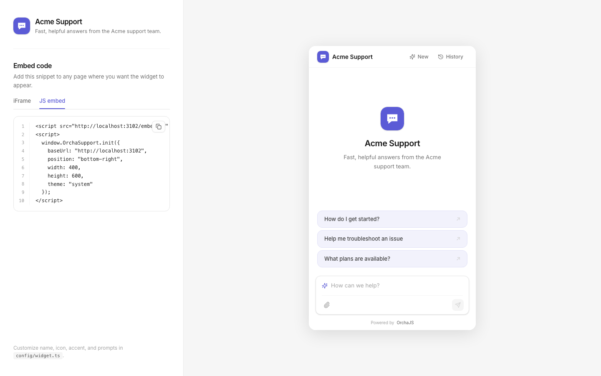
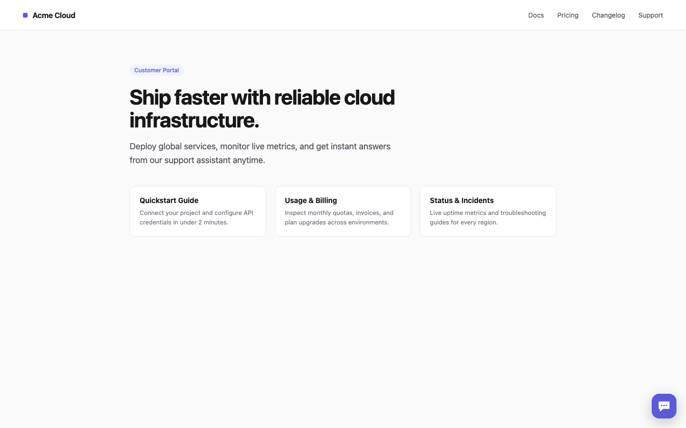
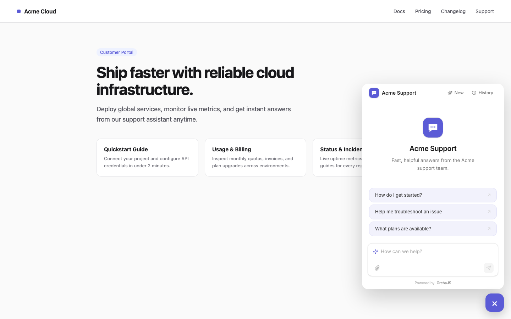

# Orcha Support Widget Template

A self-hosted, embeddable AI support widget built with Next.js and **[OrchaJS](https://github.com/Amarsia/orcha)** ([`orchajs` on npm](https://www.npmjs.com/package/orchajs)). Use it as a drop-in starter for your website or as a reference tutorial for building secure, iframe-embeddable OrchaJS agents.



## Links

- **OrchaJS GitHub**: [github.com/Amarsia/orcha](https://github.com/Amarsia/orcha)
- **OrchaJS npm package**: [npmjs.com/package/orchajs](https://www.npmjs.com/package/orchajs)

---

## What's Included

- **Embeddable launcher + iframe UI** — Includes `/embed.js` (a zero-dependency floating button & responsive drawer script) and `/widget` (the iframe chat UI), plus a live preview + copyable snippet generator at `/`.
- **Single-file widget configuration** — Edit `config/widget.ts` to customize the widget name, subtitle, icon/launcher mark, accent color, theme, suggested prompts, disclaimer, attribution, and upload limits.
- **File uploads in chat** — Visitors can attach images and documents (`POST /api/uploads`) passed directly to OrchaJS as durable file content items.
- **Signed visitor isolation** — Conversations and uploaded files are scoped per visitor via an HMAC-signed, `HttpOnly`, `SameSite=None; Partitioned` cookie so third-party embeds stay isolated.
- **Server-side OrchaJS execution** — Provider/Amarsia keys stay on the server; responses stream over NDJSON (`POST /api/chat`).
- **Built-in production guardrails** — Single-container rate limiting (`lib/rate-limit.ts`), CSP `frame-ancestors` allowlist (`WIDGET_ALLOWED_ORIGINS`), and strict `postMessage` origin verification.

---

## How the Orcha-Powered Design Works

1. **Filesystem-convention agent (`orcha/`)**
   - `orcha/index.ts` initializes OrchaJS with Amarsia AI Gateway and cloud-backed session storage (or local/direct providers if configured).
   - `orcha/assistant/index.json` selects the model (`provider`, `model`, `maxTokens`).
   - `orcha/assistant/instructions.md` defines support policies, tone, and boundaries.
   - `orcha/assistant/tests/` holds automated agent behavior tests run with `npm run agent:test`.
2. **Host preview & embed script (`app/page.tsx`, `app/embed.js/route.ts`)**
   - Visiting `/` opens a split workspace with embed configuration/snippets in the left sidebar and an interactive live widget preview on the right.
   - Any site can embed the widget with one `<script>` tag pointing to `/embed.js`; the launcher reads non-secret branding (`name`, `icon`, `accent`, `launcherLabel`) from `/api/config`.
3. **Iframe runtime (`app/widget/page.tsx`, `components/support-widget.tsx`)**
   - Manages visitor conversations, file attachments, markdown rendering, streaming responses, and light/dark/system themes inside the iframe.

---

## Quick Start

### 1. Install dependencies

```bash
npm install
cp .env.example .env.local
```

### 2. Configure environment variables

Choose either **Amarsia AI Gateway** (includes free credits, cloud session storage, and telemetry) or **your own model provider keys** (`OPENAI_API_KEY`, `ANTHROPIC_API_KEY`, etc.):

**Option A — Amarsia AI Gateway (includes free credits):**

1. Sign up on [Amarsia](https://amarsia.com), go to **Projects**, click **Connect New Project**, and copy the generated project key.
2. Add it to `.env.local`:

```dotenv
AMARSIA_PROJECT_KEY=your_project_key
VISITOR_COOKIE_SECRET=replace-with-at-least-32-random-characters

# Comma-separated origins allowed to frame /widget in production
# WIDGET_ALLOWED_ORIGINS=https://www.example.com,https://app.example.com

# Optional custom Amarsia API endpoint
AMARSIA_API_URL=https://api.amarsia.com
```

**Option B — Your own model provider keys:**

If you prefer not to use Amarsia AI Gateway, update `orcha/index.ts` to pass `providers: { openai: process.env.OPENAI_API_KEY ?? "" }` (or `anthropic`, `googlegenai`, `deepseek`, `bedrock`, `vertexai`) instead of `amarsia`, and adjust the key check in `lib/server.ts`. See the [OrchaJS documentation](https://github.com/Amarsia/orcha) for all provider shapes.

### 3. Run the development server

```bash
npm run dev
```

- **Preview & embed builder**: [http://localhost:3000](http://localhost:3000)
- **Standalone widget route**: [http://localhost:3000/widget](http://localhost:3000/widget)

> Note: `npm run dev` runs `orchajs build` at startup. Restart `npm run dev` whenever you modify files under `orcha/`.

---

## Embedding on Your Website

When embedded via `/embed.js`, the widget renders a floating launcher button in the corner of your site that opens the chat iframe on click:

| Floating Launcher | Open Support Drawer |
| --- | --- |
|  |  |

### Auto-initialized script tag

Add this snippet before `</body>` on any webpage (replacing `https://support.example.com` with your deployed origin):

```html
<script
  src="https://support.example.com/embed.js"
  data-base-url="https://support.example.com"
  data-position="bottom-right"
  data-width="400"
  data-height="600"
  data-theme="system"
  async
></script>
```

### Manual initialization

Disable auto-init and call `window.OrchaSupport.init(...)` programmatically (for example after consent or login):

```html
<script src="https://support.example.com/embed.js" data-auto-init="false"></script>
<script>
  window.OrchaSupport.init({
    baseUrl: "https://support.example.com",
    position: "bottom-left",
    width: 400,
    height: 600,
    theme: "system"
  });
</script>
```

Valid `position` values: `"bottom-right"` | `"bottom-left"`.  
Valid `theme` values: `"light"` | `"dark"` | `"system"`.

---

## Customization Guide

### Branding, Icons, Accent Color, and Uploads (`config/widget.ts`)

Editing `config/widget.ts` automatically updates the favicon, landing preview, widget header, welcome screen, assistant avatar, and the floating `/embed.js` launcher button:

- `name`, `description`, `launcherLabel` — Widget title, welcome subtitle, and accessible launcher label.
- `icon` — Path in `public/` (or URL) used consistently across the app and floating launcher.
- `accent` — 6-digit hex brand color used for buttons, highlights, and launcher styling.
- `theme` — Default theme (`"light" | "dark" | "system"`).
- `placeholder` & `suggestedPrompts` — Composer placeholder and starter prompt chips.
- `allowFileUploads` & `maxFileSizeMb` — Enable/disable file attachments and set max file size.
- `disclaimer` & `poweredBy` — Footer disclaimer and attribution link.

### Support Agent Behavior (`orcha/assistant/`)

- **Model**: Edit `orcha/assistant/index.json`.
- **Knowledge & instructions**: Edit `orcha/assistant/instructions.md` (add your product docs, pricing rules, escalation policy, or custom actions/skills).
- **Playground & tests**:

```bash
npm run agent:playground
npm run agent:test
```

---

## API Endpoints

| Route | Method | Description |
| --- | --- | --- |
| `/api/chat` | `POST` | Starts or resumes a visitor conversation and streams NDJSON. |
| `/api/sessions` | `GET` | Lists conversations belonging to the signed visitor. |
| `/api/sessions/[sessionId]` | `GET` | Loads message & attachment history for a visitor-owned session. |
| `/api/uploads` | `POST` | Saves a visitor-scoped multipart upload under `.orcha/uploads/<visitorId>/`. |
| `/api/uploads/[fileId]` | `GET` | Serves a visitor-owned uploaded file. |
| `/api/config` | `GET` | Exposes non-secret branding (`name`, `icon`, `accent`, `launcherLabel`) for `/embed.js`. |
| `/embed.js` | `GET` | Serves the self-hosted floating launcher & iframe loader script. |

---

## Security & Deployment

- **Origin lock**: Set `WIDGET_ALLOWED_ORIGINS` in production (for example `https://www.example.com,https://app.example.com`) so only your domains can frame `/widget` via CSP `frame-ancestors`.
- **Cookie secret**: Always set a unique `VISITOR_COOKIE_SECRET` (32+ characters) in production.
- **Rate limiting**: `lib/rate-limit.ts` is process-local for single-instance deployments; swap in Redis/Upstash if running multiple replicas.
- **Docker**:

```bash
docker build -t orcha-support-widget .
docker run \
  --env-file .env.local \
  -p 3000:3000 \
  -v orcha-support-sessions:/app/.orcha \
  orcha-support-widget
```

---

## License

MIT
